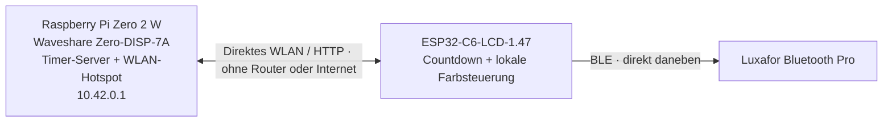

# Pi Timer WiFi

Neufassung von [sglogger/pi-timer](https://github.com/sglogger/pi-timer) für den
SwiNOG-Konferenztimer: Die lange Funkstrecke läuft über WLAN. Der ESP32-C6 neben
dem Redner zeigt die Zeit und steuert das **Luxafor Bluetooth Pro direkt per BLE**.
Der Pi stellt standardmäßig sein eigenes WLAN bereit: **kein Router, kein
Veranstaltungs-WLAN und kein Internet vor Ort nötig**. Ein vorhandenes gemeinsames
WLAN ist als alternative Konfiguration möglich.



**Stand: erste implementierte Version, noch nicht auf der konkreten Hardware
abgenommen.** Server, Synchronisation und Timerregeln werden automatisiert
getestet. BLE-Befehle sind aus einer veröffentlichten Bluetooth-Pro-Implementierung
abgeleitet; tatsächliche Gerätekompatibilität, Display und Reichweite müssen vor
dem Einsatz geprüft werden. Das ursprüngliche Repository bleibt erhalten.

## Was sich ändert

- Kein Bluetooth zwischen Regie und Redner mehr, kein Luxafor-Dongle am Headend.
- Eigenes WPA2-WLAN auf dem Pi; ESP32 verbindet sich direkt mit `SwiNOG-Timer`.
- ESP32 holt alle 500 ms den vollständigen Timerzustand. Keine Befehlswarteschlange,
  die nach einem Ausfall veraltete Starts nachliefert.
- Lokaler monotoner Countdown und Farbwechsel laufen bei WLAN-Ausfall weiter.
- Automatische WLAN-/BLE-Wiederverbindung, frischer Zustand nach Reconnect.
- Touch-Oberfläche zeigt getrennt Headend, ESP32-Synchronisation und Luxafor-BLE.
- Presets: 30, 25, 20, 15, 10, 5 und 1 Minute. API: 1–120 Minuten.
- Kein Cloud-Dienst, kein MQTT-Broker und keine NTP-Abhängigkeit für den Countdown.

| Restzeit | Display / Luxafor |
|---|---|
| Mehr als 5 Minuten | Grün |
| Bis 5 Minuten | Gelb |
| Bis 1 Minute | Orange |
| Ab 0 | Rot |
| Ab 30 Sekunden Überzeit | Rot blinkend |
| Stop | Licht aus, Display READY |

Ein kurzer Timer beginnt sofort in seiner passenden Warnfarbe. Im bisherigen
Projekt unterschieden sich manche Grenzwerte zwischen Browser, ESP32 und Licht;
hier gelten die Grenzen aus dieser Tabelle.

## Inbetriebnahme

**Hier starten: [Schritt-für-Schritt-Installation](docs/INSTALLATION.md)** — vom
frischen Pi-OS über ESP32-Flashen bis zum ersten vollständig offline laufenden Timer.

| Anleitung | Inhalt |
|---|---|
| [Kompilieren](docs/BUILD.md) | Anwendung prüfen, fertige Firmware oder vollständiger MicroPython-/ESP-IDF-Eigenbau |
| [Installieren und einrichten](docs/INSTALLATION.md) | Pi-OS, Touch-Kiosk, Server, Flashen, WLAN, Konfiguration und Ersttest |
| [Betrieb und Wartung](docs/BETRIEB.md) | Einschalten, Statusanzeigen, Diagnose, Updates, Sicherung und Rollback |
| [Direktes WLAN](deploy/direct-wifi.md) | Pi-Hotspot, feste IP, Autostart und alternative WLAN-Betriebsart |
| [Hardware-Abnahme](docs/acceptance.md) | Kaltstart, Funkunterbrechungen und Reichweitentest |

Kurzablauf:

1. Vorab mit Internet: [Headend installieren](deploy/README.md), Zugriffsschlüssel erzeugen.
2. [Direktes WLAN auf dem Pi vorbereiten](deploy/direct-wifi.md), Passwort übernehmen.
3. [ESP32 vorbereiten](firmware/README.md): Hotspot-Daten, Pi-IP `10.42.0.1` und Luxafor auswählen.
4. Hotspot aktivieren; Luxafor-Dongle abziehen und belegende Luxafor-Apps schließen.
5. [Hardware-Abnahme](docs/acceptance.md) einschließlich Kaltstart ohne Internet
   und 20–30-m-Reichweitentest durchführen.

## Verhalten bei Ausfällen

- **WLAN / Server nicht erreichbar:** ESP32 zählt weiter und steuert das Licht
  lokal. Neue Start-/Stop-Befehle erreichen ihn erst nach Wiederverbindung.
  Die Bedienoberfläche zeigt die fehlende Bestätigung; ein HTTP-Erfolg allein
  bedeutet nicht, dass das Gerät den Befehl übernommen hat.
- **BLE unterbrochen:** Display und WLAN laufen weiter. Beim Wiederverbinden
  sendet der ESP32 die aktuell erforderliche Farbe. Bis dahin kann die Lampe ihre
  alte Farbe behalten; das wird nicht als erfolgreicher Lichtwechsel ausgegeben.
- **ESP32-Neustart:** Countdown unbekannt, Licht zunächst aus. Nach WLAN-Sync
  übernimmt er den aktuellen Timer. Ohne Headend kann er ihn nicht rekonstruieren.
- **Headend-Neustart:** neue Sitzung, Timer gestoppt. ESP32 übernimmt Stop beim
  nächsten erfolgreichen Sync. Ein aktuell offline laufender ESP32 zählt bis dahin weiter.
- **BLE-Status:** bedeutet GATT-Verbindung und gesendeter Befehl. Das verwendete
  Write-without-response-Protokoll bestätigt nicht die sichtbare LED-Farbe.

## Entwicklung

Python 3.11 oder neuer:

```sh
./install.sh
.venv/bin/python -m unittest discover -s tests -v
.venv/bin/python -m compileall -q server.py firmware tools
./run.sh
```

Hardwarelosen Knoten in einem zweiten Terminal simulieren:

```sh
set -a
. ./.env
set +a
.venv/bin/python tools/simulate_node.py
```

Die Simulation meldet absichtlich keine bestehende Luxafor-Verbindung.

## Aufbau und Quellen

- `server.py`: threadsicherer Timer, REST-API und Touch-Oberfläche.
- `firmware/`: MicroPython mit aioble, asynchronem HTTP und Waveshare-Display.
- [Architektur und Protokoll](docs/architecture.md).
- [BLE-Protokoll, Herkunft und Grenzen](docs/ble-protocol.md).
- [Quellen und übernommene Bestandteile](NOTICE.md).

Das neue Projekt enthält keine WLAN-Passwörter, individuellen Gerätemerkmale oder
Zugriffsschlüssel. `.env`, `firmware/config.py` und BLE-Bondingdaten sind ignoriert.
