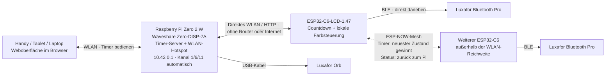
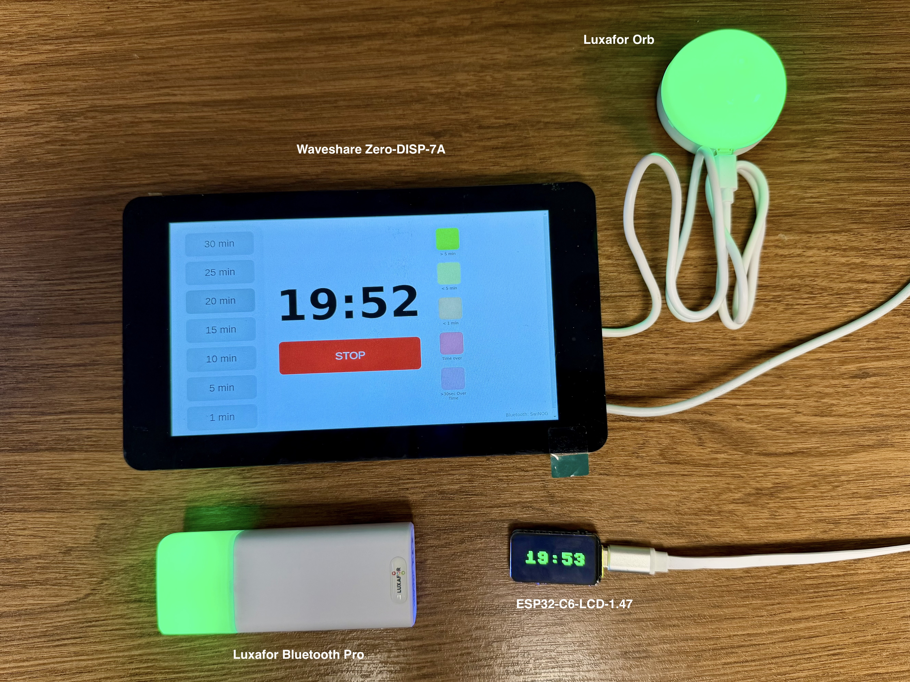

# Pi Timer WiFi

Neufassung von [sglogger/pi-timer](https://github.com/sglogger/pi-timer) für den
SwiNOG-Konferenztimer: Die lange Funkstrecke läuft über WLAN. Der ESP32-C6 neben
dem Redner zeigt die Zeit und steuert das **Luxafor Bluetooth Pro direkt per BLE**.
Am Headend zeigt eine per USB-Kabel angeschlossene **Luxafor Orb** weiterhin
dieselben Farben wie im ursprünglichen Projekt.
Der Pi stellt standardmäßig sein eigenes WLAN bereit: **kein Router, kein
Veranstaltungs-WLAN und kein Internet vor Ort nötig**. Ein vorhandenes gemeinsames
WLAN ist als alternative Konfiguration möglich.



**Stand: Version 1.2.0 (siehe [CHANGELOG](CHANGELOG.md)).** Hotspot, ESP32-WLAN und
BLE-Verbindung laufen seit 0.7.1 auf der Hardware; die vollständige
[Hardware-Abnahme](docs/acceptance.md) steht noch aus. Server, Synchronisation und
Timerregeln werden automatisiert getestet. BLE-Befehle sind aus einer veröffentlichten Bluetooth-Pro-Implementierung
abgeleitet; tatsächliche Gerätekompatibilität, Display und Reichweite müssen vor
dem Einsatz geprüft werden. Das ursprüngliche Repository bleibt erhalten.

## Was sich ändert

- Kein Bluetooth zwischen Regie und Redner mehr, kein Luxafor-Dongle am Headend.
- Luxafor Orb am Headend per USB wie bisher: gleiche Farben und USB-Befehle wie
  `luxafor-linux.py`, jetzt direkt im Timer-Server statt über geplante Einzelbefehle.
  Wird automatisch erkannt, auch nach Abziehen und erneutem Einstecken.
- Eigenes WPA2-WLAN auf dem Pi; ESP32 verbindet sich direkt mit `SwiNOG-Timer`.
  Beim Booten wählt der Pi den am wenigsten belegten Kanal (1, 6 oder 11).
- Mehrere ESP32 synchronisieren sich zusätzlich per ESP-NOW-Mesh untereinander:
  Ein Gerät ohne WLAN übernimmt den Timer von einem Nachbarn mit WLAN.
- Das Headend zeigt jeden ESP32 einzeln (WLAN oder „Mesh über …“, Bestätigung,
  Luxafor); Firmware-Versionen stehen unter **WLAN / IP**.
- ESP32 holt alle 500 ms den vollständigen Timerzustand. Keine Befehlswarteschlange,
  die nach einem Ausfall veraltete Starts nachliefert.
- Lokaler monotoner Countdown und Farbwechsel laufen bei WLAN-Ausfall weiter.
- Automatische WLAN-/BLE-Wiederverbindung, frischer Zustand nach Reconnect.
- **Native Tkinter-Touch-App als Standard am Pi Zero 2 W**: keine Browser-Engine,
  automatische Anmeldung aus `.env`, große Zeit-/Stop-Tasten. Weboberfläche optional.
- Oberfläche zeigt getrennt Headend, jeden ESP32 mit Synchronisation und Luxafor-BLE sowie Luxafor-USB.
- Handy, Tablet oder Laptop können denselben Timer über die Weboberfläche im
  Pi-WLAN steuern, auch gleichzeitig mit der nativen Touch-App.
- Presets: 30, 25, 20, 15, 10, 5 und 1 Minute. API: 1–120 Minuten.
- Kein Cloud-Dienst, kein MQTT-Broker und keine NTP-Abhängigkeit für den Countdown.

| Restzeit | Display / Luxafor |
|---|---|
| Mehr als 5 Minuten | Grün |
| Bis 5 Minuten | Gelb |
| Bis 1 Minute | Orange |
| Ab 0 | Rot |
| Ab 30 Sekunden Überzeit | Rot blinkend |
| Stop | Licht aus, Display READY |

Die Orb am Headend folgt denselben Grenzen. Beim Überziehen sendet der Server wie
im ursprünglichen Projekt einen roten Luxafor-Strobe (Geschwindigkeit 15, 30 Wiederholungen).

Ein kurzer Timer beginnt sofort in seiner passenden Warnfarbe. Im bisherigen
Projekt unterschieden sich manche Grenzwerte zwischen Browser, ESP32 und Licht;
hier gelten die Grenzen aus dieser Tabelle.

## Hardware

| Komponente | Rolle |
|---|---|
| Raspberry Pi Zero 2 W | Timer-Server, WLAN-Hotspot, native Touch-App |
| [Waveshare Zero-DISP-7A](https://www.waveshare.com/zero-disp-7a.htm) ([Wiki](https://www.waveshare.com/wiki/Zero-DISP-7A)) | 7-Zoll-Touchdisplay als Träger für den Pi |
| [Waveshare ESP32-C6-LCD-1.47](https://www.waveshare.com/wiki/ESP32-C6-LCD-1.47) | Countdown-Anzeige beim Redner, steuert die Lampe per BLE |
| Luxafor Bluetooth Pro | Farbsignal beim Redner |
| Luxafor Orb | Farbsignal am Headend, per USB-Kabel am Zero-DISP-7A |




Die Fotos stammen aus dem [ursprünglichen Projekt](https://github.com/sglogger/pi-timer)
und zeigen dessen Bluetooth-Aufbau mit der früheren Browser-Oberfläche. Die Luxafor
Orb bleibt; der USB-Dongle für die Luxafor Bluetooth Pro wird in dieser WLAN-Version
nicht mehr benötigt.

## Inbetriebnahme

**Hier starten: [Schritt-für-Schritt-Installation](docs/INSTALLATION.md)** — vom
frischen Pi-OS über ESP32-Flashen bis zum ersten vollständig offline laufenden Timer.

| Anleitung | Inhalt |
|---|---|
| [Kompilieren](docs/BUILD.md) | Anwendung prüfen, fertige Firmware oder vollständiger MicroPython-/ESP-IDF-Eigenbau |
| [Installieren und einrichten](docs/INSTALLATION.md) | Pi-OS, native Touch-App, Server, Flashen, WLAN, Konfiguration und Ersttest |
| [Native Oberfläche](docs/NATIVE_UI.md) | Schlanker X11-Betrieb, Desktop-Alternative, Ressourcenprüfung |
| [Betrieb und Wartung](docs/BETRIEB.md) | Einschalten, Statusanzeigen, Diagnose, Updates, Sicherung und Rollback |
| [Direktes WLAN](deploy/direct-wifi.md) | Pi-Hotspot, feste IP, Autostart und alternative WLAN-Betriebsart |
| [Hardware-Abnahme](docs/acceptance.md) | Kaltstart, Funkunterbrechungen und Reichweitentest |

Kurzablauf:

1. Vorab mit Internet: [Headend installieren](deploy/README.md), Zugriffsschlüssel erzeugen.
2. [Direktes WLAN auf dem Pi vorbereiten](deploy/direct-wifi.md), Passwort übernehmen.
3. [ESP32 vorbereiten](firmware/README.md): Hotspot-Daten, Pi-IP `10.42.0.1` und Luxafor auswählen.
4. Hotspot aktivieren; Luxafor-Dongle abziehen und belegende Luxafor-Apps schließen.
5. [Hardware-Abnahme](docs/acceptance.md) einschließlich Kaltstart ohne Internet
   und 20–30-m-Reichweitentest durchführen.

## Mit Handy, Tablet oder Laptop über WLAN steuern

Die Weboberfläche ist bereits enthalten und passt sich kleinen Bildschirmen an.
Eine zusätzliche Handy-App oder Internetverbindung ist nicht erforderlich.
Voraussetzung: Pi-Hotspot und Timer-Server sind nach der
[Installationsanleitung](docs/INSTALLATION.md) eingerichtet und laufen.

1. Auf dem Handy, Tablet oder Laptop das WLAN **`SwiNOG-Timer`** auswählen.
2. Mit dem bei der [Hotspot-Einrichtung](deploy/direct-wifi.md) erzeugten
   **WLAN-Passwort** verbinden. Meldet das Gerät „WLAN ohne Internet“, trotzdem
   mit diesem WLAN verbunden bleiben.
3. Im Browser **[http://10.42.0.1:8000](http://10.42.0.1:8000)** öffnen.
4. Den **Zugriffsschlüssel** eingeben: den Wert hinter `PI_TIMER_TOKEN=` aus der
   `.env`-Datei im Projektverzeichnis auf dem Pi. Dieser Schlüssel ist unabhängig
   vom WLAN-Passwort. Er bleibt für die Browser-Sitzung gespeichert; bei einer
   neuen Sitzung gegebenenfalls erneut eingeben. Ein falsch eingegebener Schlüssel
   ersetzt einen bereits gültigen nicht. Lehnt der Server den gespeicherten Schlüssel
   ab (z. B. nach neu erzeugter `.env`), wird er verworfen und erneut abgefragt.
5. Eine Zeit wählen oder **STOP** drücken. Countdown, ESP32-Synchronisation und
   Luxafor-BLE-Status werden auch auf dem mobilen Gerät angezeigt.

Die native App am Pi und alle verbundenen Browser bedienen **denselben Timer**.
Änderungen werden laufend abgeglichen; der zuletzt vom Server angenommene
Start-/Stop-Befehl gilt. Das Schließen des Browsers oder Trennen des Handys vom
WLAN stoppt den Timer nicht. Zum Beenden ausdrücklich **STOP** drücken und die
ESP32-Bestätigung abwarten.

Falls Pi und Handy alternativ in einem vorhandenen gemeinsamen WLAN betrieben
werden, statt `10.42.0.1` die dortige Pi-IP verwenden; Port `8000` bleibt gleich.
Der Zugriff erfolgt innerhalb desselben lokalen Netzes. Für die normale
Bedienung muss kein Port am Internetrouter freigegeben werden.

## Mehrere Rednergeräte an einem Pi

**Mehrere ESP32 können denselben Countdown anzeigen und jeweils eine eigene
Luxafor-Lampe steuern.** Jeder ESP32 holt den gemeinsamen Sollzustand vom Pi.
Start und STOP gelten damit für alle verbundenen Geräte; eine Geräteauswahl oder
unabhängige Timer pro Redner/Raum gibt es in dieser Version nicht. Die Anzeigen
werden per Polling synchronisiert, nicht auf die Millisekunde gleichzeitig.

**ESP-NOW-Mesh (experimentell, standardmäßig aus):** Mit `MESH = True` tauschen die
ESP32 den Timer zusätzlich untereinander aus. Im ersten Hardwaretest fiel mit aktivem
ESP-NOW der WLAN-Abgleich aus; Ursache war ein inzwischen behobenes Socket-Leck.
Bis ein erneuter Test das Mesh bestätigt, bleibt es aus. Ein
Gerät außerhalb der Hotspot-Reichweite übernimmt Start und STOP von einem anderen
ESP32, der WLAN hat, auch über mehrere Geräte hinweg; sein Display zeigt dann
`MESH OK`. Es gibt keinen Master: Der Zustand mit dem neuesten Server-Kontakt
gewinnt. Alle Geräte brauchen denselben `API_TOKEN`. Mit `WIFI = False` arbeitet
ein Gerät nur über das Mesh, ohne je den Hotspot zu nutzen. Details:
[Architektur](docs/architecture.md#esp-now-mesh-zwischen-den-esp32).

**Statusanzeige pro Gerät:** Jeder ESP32 meldet sich mit seiner MAC-Adresse als ID
und seinem `HOSTNAME` als Namen. Touch-App und Weboberfläche listen alle Geräte
einzeln mit Weg (WLAN oder „Mesh über saal-1“), Übernahme von Start/STOP und
Luxafor-Verbindung. Geräte ohne WLAN melden ihren Status per ESP-NOW an einen
Nachbarn mit WLAN, der ihn an den Pi weitergibt. Die Meldung zählt 10 s statt 5 s
als aktuell, weil sie über das Mesh später ankommt. Ein Gerät ohne Meldung bleibt
30 Minuten als „offline“ sichtbar. Die Touch-App zeigt ein Gerät ausführlich, ab
zwei Geräten je eine Zeile und höchstens fünf; die Weboberfläche zeigt alle.
Firmware-Versionen stehen unter **WLAN / IP** bei den Geräten im Hotspot.

### Zusätzliches Gerät einrichten

1. Für jedes Rednergerät einen eigenen **ESP32-C6-LCD-1.47** und ein eigenes
   **Luxafor Bluetooth Pro** direkt daneben vorsehen. Nicht mehrere ESP32 auf
   dieselbe Lampe konfigurieren.
2. Jeden ESP32 nach [Installation, Schritte 5 und 6](docs/INSTALLATION.md)
   mit MicroPython, aioble und den Timerdateien installieren. Geräte zunächst
   einzeln per USB anschließen, damit die Konfiguration auf dem richtigen Board landet.
3. Auf allen ESP32 dieselben Werte für `WIFI_SSID`, `WIFI_PASSWORD`,
   `SERVER_IP = "10.42.0.1"`, `SERVER_PORT = 8000` und `API_TOKEN` verwenden.
   WLAN-Passwort und API-Schlüssel stammen weiterhin vom selben Pi.
4. **Pro ESP32 die zugehörige Luxafor eindeutig auswählen:** mit `firmware/scan.py`
   scannen, dabei zur Zuordnung zunächst nur die betreffende Lampe einschalten.
   Bei mehreren gleich benannten Lampen deren jeweilige `LUXAFOR_MAC` eintragen.
   Die MAC muss stabil bleiben; bei wechselnden BLE-Adressen ist ein eindeutiger
   Gerätename nötig. Die gemeinsame Beispielkonfiguration nicht unverändert
   einschließlich der Lampenzuordnung auf alle Boards kopieren.
5. Die jeweilige `config.py` auf das passende Board übertragen, neu starten und
   ESP32/Lampe als Paar beschriften. Mit `HOSTNAME` (z. B. `saal-2`) erscheint das
   Gerät am Headend unter diesem Namen statt der MAC-Adresse. Der Pi-Hotspot muss nur einmal eingerichtet
   werden; zusätzliche ESP32 benötigen keine manuelle IP-Vergabe oder Registrierung.
6. Alle Geräte gleichzeitig einschalten. Start, Farbwechsel und STOP **an jedem
   Display und jeder Lampe einzeln** prüfen. Ein Gerät absichtlich ausschalten und
   wieder verbinden; anschließend Kaltstart ohne Internet und Reichweite mit allen
   vorgesehenen Geräten plus Handy testen.

Simulierte Knoten (`PI_TIMER_NODE=saal-2 tools/simulate_node.py`) erhalten denselben
Timerzustand und STOP und erscheinen getrennt in der Statusanzeige. Ein Mehrgerätebetrieb
auf der echten Hardware und eine maximale Teilnehmerzahl sind noch nicht getestet.
Mit jedem ESP32 kommen ungefähr zwei Sync-Abfragen pro Sekunde hinzu; auch Handys
und Laptops belegen WLAN-Verbindungen. Die passende Gerätezahl muss mit dem
tatsächlichen Pi, dessen WLAN-Treiber und der Funkumgebung geprüft werden.

### Dynamische IP-Vergabe auf dem Hotspot

**Ja: Der Pi-Hotspot vergibt automatisch IP-Adressen per DHCP**, auch ohne Internet.
Das Setup verwendet NetworkManager mit `ipv4.method=shared`.

| Gerät | IP-Konfiguration |
|---|---|
| Pi / Hotspot / Timer-Server | Fest `10.42.0.1`, Netz `10.42.0.0/24` |
| Jeder ESP32 | Eigene dynamische Adresse aus diesem Netz per DHCP |
| Handy, Tablet, Laptop | Ebenfalls DHCP; IP-Einstellung auf „automatisch“ lassen |

Die ESP32-Firmware verwendet bereits die automatische IP-Konfiguration. In
`config.py` wird nur die feste **Server-Adresse** eingetragen, keine eigene
ESP32-Adresse. Die Client-Adressen dürfen nach einer Wiederverbindung wechseln:
Alle ESP32 verbinden sich von sich aus zum Pi, der ihre IPs nicht kennen muss.
Keine eigene DHCP-/dnsmasq-Instanz zusätzlich zur NetworkManager-Konfiguration
starten. Details: [Direktes WLAN](deploy/direct-wifi.md).

## Verhalten bei Ausfällen

- **WLAN / Server nicht erreichbar:** ESP32 zählt weiter und steuert das Licht
  lokal. Neue Start-/Stop-Befehle erreichen ihn erst nach Wiederverbindung oder
  über einen anderen ESP32 mit WLAN in Funkreichweite (ESP-NOW-Mesh).
  Die Bedienoberfläche zeigt die fehlende Bestätigung; ein HTTP-Erfolg allein
  bedeutet nicht, dass das Gerät den Befehl übernommen hat.
- **BLE unterbrochen:** Display und WLAN laufen weiter. Beim Wiederverbinden
  sendet der ESP32 die aktuell erforderliche Farbe. Bis dahin kann die Lampe ihre
  alte Farbe behalten; das wird nicht als erfolgreicher Lichtwechsel ausgegeben.
- **ESP32-Neustart:** Countdown unbekannt, Licht zunächst aus. Nach WLAN-Sync
  übernimmt er den aktuellen Timer. Ohne Headend kann er ihn nicht rekonstruieren.
- **Headend-Neustart:** neue Sitzung, Timer gestoppt. ESP32 übernimmt Stop beim
  nächsten erfolgreichen Sync. Ein aktuell offline laufender ESP32 zählt bis dahin weiter.
- **BLE-Status:** bedeutet GATT-Verbindung und gesendeter Befehl. Das verwendete
  Write-without-response-Protokoll bestätigt nicht die sichtbare LED-Farbe.

## Entwicklung

Python 3.11 oder neuer:

```sh
./install.sh
.venv/bin/python -m unittest discover -s tests -v
.venv/bin/python -m compileall -q server.py orb.py ui_config.py native_client.py native_ui.py firmware tools
./run.sh
```

Die Firmware läuft zusätzlich auf dem MicroPython-Unix-Port
(`micropython tests/micropython/run.py`); Einrichtung in [BUILD.md](docs/BUILD.md#micropython-laufzeittest).

Hardwarelosen Knoten in einem zweiten Terminal simulieren:

```sh
set -a
. ./.env
set +a
.venv/bin/python tools/simulate_node.py
# weiteres Gerät: PI_TIMER_NODE=sim-2 .venv/bin/python tools/simulate_node.py
```

Die Simulation meldet absichtlich keine bestehende Luxafor-Verbindung.

## Aufbau und Quellen

- `native_ui.py` / `native_client.py`: native Touch-App und lokaler API-Client.
- `server.py`: threadsicherer Timer, REST-API und optionale Weboberfläche.
- `orb.py`: Luxafor Orb per USB am Headend (pyusb, Befehle aus `luxafor-linux.py`).
- `ui_config.py`: Presets, Farben und Beschriftungen für Web- und Touch-App.
- `firmware/`: MicroPython mit aioble, asynchronem HTTP und Waveshare-Display.
- [Architektur und Protokoll](docs/architecture.md).
- [BLE-Protokoll, Herkunft und Grenzen](docs/ble-protocol.md).
- [Quellen und übernommene Bestandteile](NOTICE.md).

Das neue Projekt enthält keine WLAN-Passwörter, individuellen Gerätemerkmale oder
Zugriffsschlüssel. `.env`, `firmware/config.py` und BLE-Bondingdaten sind ignoriert.
