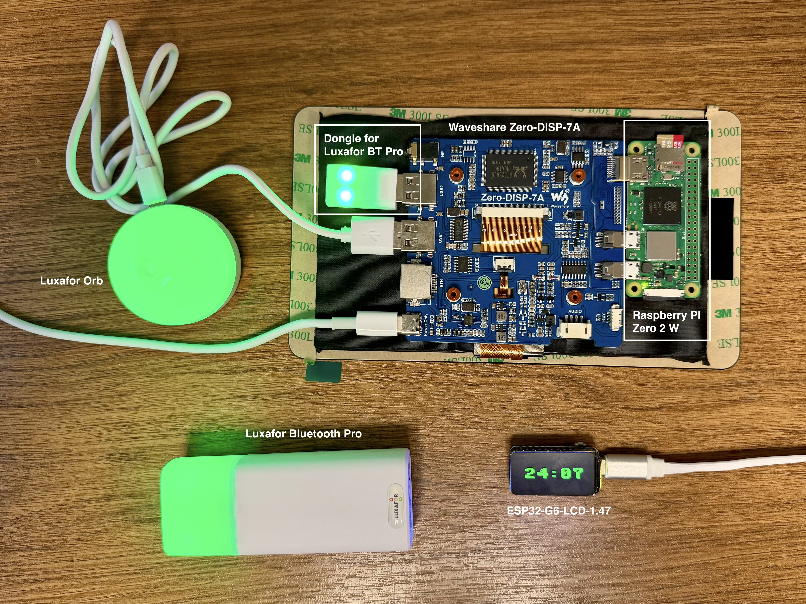

# Vom leeren System zum betriebsbereiten Pi Timer

Diese Anleitung führt durch den **Direktbetrieb ohne Infrastruktur vor Ort**:

```text
Pi Zero 2 W + Waveshare-Touchscreen <-- eigenes WLAN --> ESP32-C6-LCD-1.47 <-- BLE --> Luxafor Bluetooth Pro
                 10.42.0.1                              DHCP-Adresse
                                                              ^
                                                              | ESP-NOW-Mesh
                                                              v
                                    weitere ESP32-C6-LCD-1.47 <-- BLE --> Luxafor Bluetooth Pro
```

Weitere ESP32 sind optional. Sie erhalten den Timer per WLAN oder, außerhalb der
Hotspot-Reichweite, über das [ESP-NOW-Mesh](architecture.md#esp-now-mesh-zwischen-den-esp32).

**Einmalige Vorbereitung mit Internet zu Hause; Betrieb anschließend offline.**
Alle Hardware-Schritte sind als Inbetriebnahmeanleitung beschrieben und noch
nicht an der konkreten Gerätekombination abgenommen. Nicht direkt vor einem
Vortrag erstmals installieren.

## Übersicht: was wird wo ausgeführt?

| Bezeichnung in dieser Anleitung | Gerät / Umgebung | Aufgabe |
|---|---|---|
| **Pi** | Terminal auf dem Raspberry Pi, Benutzer `pitimer` | Server, native Touch-App, Hotspot |
| **Rechner** | Mac oder Linux-PC mit Internet und USB-Datenkabel | ESP32 flashen und Dateien übertragen |
| **ESP32** | MicroPython auf dem kleinen Waveshare-Board | Countdown, Display, BLE |

Die Shell-Beispiele gelten für bash/zsh auf macOS/Linux. Das Pi-System verwendet
Linux. Kein Arduino IDE oder PlatformIO nötig. Windows-Nutzer können die gleichen
Werkzeuge verwenden, müssen aber Python-/Toolpfade und den Port (z. B. `COM4`)
anpassen; die optionalen vollständigen Firmware-Build-Schritte sind für Linux/WSL
dokumentiert. Nicht Linux-`apt`-Befehle im Mac-Terminal ausführen.

Was „kompilieren“ hier bedeutet und wie die Basisfirmware selbst gebaut wird:
[Build-Anleitung](BUILD.md). Für die normale Installation reicht eine fertige
MicroPython-Binärdatei; die Timer-Quelldateien werden direkt ausgeführt.

## 0. Hardware und Vorbereitung

- Raspberry Pi Zero 2 W im Waveshare **Zero-DISP-7A**
  ([Produkt](https://www.waveshare.com/zero-disp-7a.htm), [Wiki](https://www.waveshare.com/wiki/Zero-DISP-7A)),
  microSD und passende Stromversorgung.
- Waveshare **ESP32-C6-LCD-1.47**, USB-Datenkabel und Stromversorgung.
  Die Variante **ESP32-C6-Touch-LCD-1.47** verwendet einen anderen Display-Controller
  und andere Pins; dafür ist diese Firmware nicht vorgesehen.
  Alternativ das Waveshare **ESP32-S3-LCD-1.69**; die Firmware erkennt es automatisch
  ([Hinweise](../firmware/README.md#esp32-s3-lcd-169)).
  Die Befehle unten gelten für das C6; Abweichungen für das S3 stehen jeweils dabei.
- Luxafor **Bluetooth Pro**, geladen und direkt neben dem ESP32.
- Optional **Luxafor Orb** mit USB-Kabel am Zero-DISP-7A (USB-A-Buchse) als
  Farbsignal am Headend, wie im ursprünglichen Projekt.
- Für die erste Einrichtung Tastatur am Pi oder SSH. Die native App liest den
  API-Schlüssel automatisch aus `.env`; im täglichen Betrieb ist keine Eingabe nötig.
- Internet während der Vorbereitung für apt, pip, Git und aioble.



Das Foto zeigt den Aufbau des [ursprünglichen Projekts](https://github.com/sglogger/pi-timer):
Der Pi Zero 2 W sitzt rechts auf der Rückseite des Zero-DISP-7A, die Luxafor Orb
steckt per USB-Kabel am Board. Der USB-Dongle für die Luxafor Bluetooth Pro wird
in dieser Version nicht verwendet; ihn abziehen, da er die Lampe sonst belegen kann.

Bei einem bestehenden Timer zuerst Konfigurationen und Daten sichern. Das alte
Repository bleibt erhalten; trotzdem überschreiben ein neues SD-Image und
`erase-flash` die Daten auf dem ausgewählten Medium. Bestehendes funktionierendes
Pi-OS/Display kann weiterverwendet werden: dann bei Schritt 2 einsteigen.

## 1. Raspberry Pi OS aufsetzen — Rechner, anschließend Pi

Im [Raspberry Pi Imager](https://www.raspberrypi.com/software/):

1. Zielgerät **Raspberry Pi Zero 2 W** auswählen.
2. **Raspberry Pi OS Lite (64-bit), Bookworm oder neuer** wählen. Der schlanke
   X11-Unterbau mit nativer Tk-App wird unten separat installiert. Ein vorhandenes
   Raspberry Pi OS mit Desktop ist ebenfalls möglich; siehe Schritt 3.
3. Die richtige microSD auswählen. Alle darauf vorhandenen Daten werden ersetzt.
4. Benutzer `pitimer`, eigenes Passwort und Hostname `pi-timer` konfigurieren.
5. WLAN für die **Vorbereitung** eintragen und SSH aktivieren. Raspberry Pi
   Connect deaktiviert lassen; es wird nicht benötigt.
6. Land/Zeitzone/Tastatur setzen, z. B. CH, Europe/Zurich und `ch` beim Einsatz in der Schweiz.
7. Image schreiben, microSD einsetzen, Pi starten.

Am Pi anmelden oder vom Rechner `ssh pitimer@pi-timer.local` verwenden. Wenn mDNS
nicht verfügbar ist, die vom Heimrouter zugeteilte IP statt des Namens verwenden.

**Pi:**

```sh
sudo apt update
sudo apt full-upgrade -y
sudo apt install -y git gh python3-venv python3-tk fonts-dejavu-core network-manager dnsmasq-base curl \
  xserver-xorg x11-xserver-utils xinit libusb-1.0-0
sudo reboot
```

Nach Neustart erneut anmelden. NetworkManager ist die Voraussetzung für den
Hotspot. Andere Netzwerkmanager nicht parallel auf `wlan0` konfigurieren.

### Display vor dem Timer prüfen

Zielauflösung ist **1024 × 600**. Montage/HDMI-/Touch-Verbindungen nach der
[Waveshare-Anleitung](https://www.waveshare.com/wiki/Zero-DISP-7A) prüfen.
Ein funktionierendes vorhandenes Display-Setup unverändert übernehmen.

Bei frischem Raspberry Pi OS mit KMS zunächst die automatische HDMI-Erkennung
verwenden. Falls die Auflösung falsch ist, `/boot/firmware/cmdline.txt` sichern:

```sh
sudo cp -n /boot/firmware/cmdline.txt /boot/firmware/cmdline.txt.before-pi-timer
sudo nano /boot/firmware/cmdline.txt
```

In dieser Datei **die vorhandene einzige Zeile erhalten** und am Ende, durch ein
Leerzeichen getrennt, ergänzen (vorhandenen Eintrag für denselben Ausgang ersetzen):

```text
video=HDMI-A-1:1024x600M@60D
```

Danach neu starten und Darstellung/Touch-Zuordnung prüfen. `HDMI-A-1` ist der
typische Ausgang; bei abweichender Hardware den tatsächlich verbundenen Ausgang
verwenden. Siehe [Raspberry Pi: KMS-Anzeigemodus](https://www.raspberrypi.com/documentation/computers/configuration.html#set-the-kms-display-mode).

**Nur ohne KMS (Legacy-Grafikpfad):** Die Waveshare-Anleitung, nach der das
ursprüngliche Projekt eingerichtet wurde, ergänzt stattdessen am Ende von
`config.txt` im Boot-Verzeichnis der microSD (`/boot/firmware/config.txt`):

```text
hdmi_force_hotplug=1
config_hdmi_boost=10
hdmi_group=2
hdmi_mode=87
hdmi_cvt 1024 600 60 6 0 0 0
```

Diese Angaben wirken nur mit dem Legacy-Grafiktreiber. Entweder diesen Block oder
den `video=`-Eintrag verwenden, nicht beides blind mischen.

## 2. Timer-Server installieren — Pi

Das Repository bleibt bis zur Hardware-Abnahme **privat**. Auf jedem Rechner,
der es klont, zuerst GitHub-Zugriff einrichten. Auf dem Pi ist `gh` oben installiert;
am Mac/Linux-Rechner bei Bedarf die [GitHub CLI](https://cli.github.com/) installieren:

```sh
gh auth login
gh auth setup-git
```

Ein Konto mit Zugriff auf `sglogger/pi-timer-wifi` verwenden. Alternativ einen
bereits eingerichteten SSH-Schlüssel und die SSH-Clone-URL verwenden.

Als Benutzer `pitimer` im Home-Verzeichnis, nicht als root:

```sh
cd ~
git clone https://github.com/sglogger/pi-timer-wifi.git
cd pi-timer-wifi
./install.sh
```

Ergebnis: Python-Umgebung `.venv`, installierte Serverpakete und `.env` mit einem
zufälligen API-Schlüssel. Bei erneutem `install.sh` bleibt eine vorhandene `.env`
erhalten. Schlüssel lokal anzeigen und für den ESP32 notieren:

```sh
cat .env
```

Der Wert hinter `PI_TIMER_TOKEN=` ist der API-Schlüssel. Er wird ohne diesen
Variablennamen als `API_TOKEN` in die ESP32-Konfiguration übernommen. Die native
Pi-App lädt ihn beim Start automatisch aus `.env`. Die optionale Weboberfläche
fragt ihn beim ersten Öffnen einer Browser-Sitzung ab. Noch nicht mit dem später erzeugten WLAN-Passwort verwechseln.

### Luxafor Orb am Headend

Die Orb wird vom Timer-Server selbst angesteuert (`orb.py`), ohne Root-Rechte.
Dafür einmalig die USB-Berechtigung einrichten; sie ersetzt die Regel, die das
alte `install.sh` angelegt hat:

```sh
sudo cp deploy/99-luxafor.rules /etc/udev/rules.d/99-luxafor.rules
sudo udevadm control --reload-rules
sudo udevadm trigger
groups | grep -qw plugdev || sudo usermod -aG plugdev "$USER"
```

Die Regel gibt Luxafor-USB-Geräten (`04d8:f372`) der Gruppe `plugdev` Schreibzugriff.
Nach `usermod` neu anmelden. Die Orb einstecken und prüfen: `lsusb | grep -i 04d8:f372`.
Mehrere angeschlossene Luxafor-USB-Lampen zeigen alle dieselbe Farbe. Ohne Orb
läuft der Timer normal; die Oberfläche zeigt dann „Luxafor USB nicht gefunden“.
Wer keine Orb verwendet, kann die Ansteuerung mit `PI_TIMER_ORB=0` in `.env` abschalten.

Bei Migration den alten Timer-Dienst gezielt stoppen, da beide Port 8000 verwenden:

```sh
systemctl list-unit-files --type=service | grep -i timer
sudo ss -ltnp 'sport = :8000'
```

Nur den tatsächlich identifizierten alten Timer-Dienst mit `sudo systemctl disable
--now DIENSTNAME` stoppen. Danach den neuen Server zunächst manuell starten:

```sh
./run.sh
```

In einem zweiten Pi-Terminal: `curl -I http://127.0.0.1:8000/` muss HTTP 200 liefern.
Alternativ vom Rechner `http://PI-IP:8000` öffnen und API-Schlüssel eingeben.
Ohne ESP32 sind die Gerätestatus noch offline. Ein Test-Start darf trotzdem im
Browser zählen; eine angeschlossene Orb leuchtet dabei bereits grün. Danach Stop drücken. Den manuell laufenden Server mit Ctrl-C
beenden, bevor der Dienst gestartet wird.

### Server-Autostart

Die mitgelieferte Unit verwendet `/home/pitimer/pi-timer-wifi` und Benutzer `pitimer`.
Bei anderem Benutzernamen die Unit statt mit `cp` so installieren (als dieser Benutzer,
Repository unter `~/pi-timer-wifi`); das passt `User` und alle Pfade an:

```sh
sudo sed -e "s/^User=pitimer/User=$USER/" -e "s#/home/pitimer/#$HOME/#g" \
  deploy/pi-timer-wifi.service | sudo tee /etc/systemd/system/pi-timer-wifi.service >/dev/null
```

Mit Benutzer `pitimer`:

```sh
sudo cp deploy/pi-timer-wifi.service /etc/systemd/system/
```

Anschließend:

```sh
sudo systemctl daemon-reload
sudo systemctl enable --now pi-timer-wifi
systemctl is-active pi-timer-wifi
```

Erwartet: `active`. Fehler mit `journalctl -u pi-timer-wifi -n 50 --no-pager` lesen.
Meldet `systemctl` „failed because of unavailable resources“, passen Benutzer oder
Pfade in der Unit nicht (meist fehlt die `.env` unter dem eingetragenen Pfad).

## 3. Native Touch-App und Autologin — Pi

Standard ist **Tkinter direkt auf X11**, ohne Browser, Desktop-Shell oder Windowmanager.
Die App verwendet die Python-Standardbibliothek, das Systempaket `python3-tk` und für
den WLAN-QR-Code das Paket `qrcode` aus `requirements.txt` (installiert `install.sh`).
Zuerst prüfen:

```sh
.venv/bin/python -c 'import tkinter; print("Tk", tkinter.TkVersion)'
```

Bei Importfehler `sudo apt install python3-tk` ausführen und `./install.sh` mit dem
System-`python3` erneut starten. Tkinter wird nicht mit pip installiert.

Die folgenden Autostart-Schritte gelten für eine frische **Lite-Installation**.
Bei vorhandenem Desktop dort `./run-native.sh` starten und dessen Autostart benutzen;
nicht zusätzlich eine zweite X11-Sitzung starten. Details und `.desktop`-Beispiel:
[Native Oberfläche](NATIVE_UI.md). Bestehenden Browser-Kiosk zuerst deaktivieren.

Als Timer-Benutzer (z. B. `pitimer`), aus `~/pi-timer-wifi`. `native.xinitrc`
startet die App aus `$HOME/pi-timer-wifi` und funktioniert so mit jedem Benutzernamen:

```sh
test ! -f ~/.xinitrc || cp -n ~/.xinitrc ~/.xinitrc.before-pi-timer
install -m 755 deploy/native.xinitrc ~/.xinitrc
```

In `~/.bash_profile` genau einmal diesen Block ergänzen. Vorhandenen Inhalt und
bereits funktionierende Autostart-Regeln prüfen und beibehalten:

```sh
if [ -z "$DISPLAY" ] && [ "$(tty)" = /dev/tty1 ]; then
    exec startx
fi
```

Als Timer-Benutzer `sudo raspi-config` starten und **Console Autologin** wählen;
raspi-config richtet ihn für den Benutzer ein, der `sudo` aufgerufen hat. Nicht
Desktop Autologin wählen. Je nach OS-Version unter System Options → *S5 Boot / Auto
Login* → *B2 Console Autologin* oder getrennt unter *S5 Boot* → *Console* und
*S6 Auto Login* → *Yes*. Ohne Menü: `sudo raspi-config nonint do_boot_behaviour B2`. Lokal auf dem Pi testen: aus der Textkonsole `startx`
aufrufen oder neu starten. X11 nicht über eine reine SSH-Sitzung mit `startx` starten.

Erwartet: Timer-Oberfläche im Vollbild, alle sieben Zeitknöpfe und Stop bedienbar.
Die App übernimmt `.env` automatisch. F11 schaltet Vollbild um, Esc verlässt das
Vollbild. Für Wartung ist eine zweite Textkonsole über Ctrl-Alt-F2 möglich.
Das Schließen/Neustarten der App stoppt einen laufenden Timer nicht; dafür STOP
verwenden. Der separate Server-Dienst läuft weiter. Beim Server-Neustart dagegen
wird der Timer zurückgesetzt.

Die alternative Weboberfläche bleibt unter `http://localhost:8000` verfügbar.
Für einen Browser-Kiosk siehe [NATIVE_UI.md](NATIVE_UI.md#optionale-weboberfläche).

## 4. Eigenes WLAN vorbereiten — Pi

Solange noch Internet für Downloads verfügbar ist:

```sh
cd ~/pi-timer-wifi
nmcli --get-values WIFI-PROPERTIES.AP device show wlan0
sudo python3 deploy/setup_hotspot.py
```

Die erste Ausgabe muss `yes` lauten. Das Setup erzeugt das Profil, aktiviert es
aber noch nicht. Ausgegeben werden `WIFI_SSID`, ein zufälliges `WIFI_PASSWORD` und
`SERVER_IP = "10.42.0.1"`. Diese Werte für Schritt 6 notieren.

Das WLAN-Land muss zum Einsatzort passen (`sudo raspi-config`). Den Direktbetrieb
erst in Schritt 7 aktivieren, nachdem die ESP32-Dateien installiert sind.
Details und Rückkehr ins Heim-WLAN: [Direktes WLAN](../deploy/direct-wifi.md).

## 5. ESP32-Basisfirmware und Werkzeuge — Rechner

ESP32 mit einem **Datenkabel** am Rechner anschließen. Thonny/serielle Monitore
schließen, damit sie den USB-Port nicht blockieren. Python 3 und Git müssen auf
dem Rechner installiert sein.

```sh
git clone https://github.com/sglogger/pi-timer-wifi.git
cd pi-timer-wifi
python3 -m venv .venv-board
.venv-board/bin/python -m pip install mpremote 'esptool>=5,<6'
.venv-board/bin/mpremote connect list
```

Falls das Repository hier schon existiert, diesen Clone-Schritt überspringen und
das vorhandene Verzeichnis verwenden. Port aus der Liste übernehmen, z. B. auf
macOS (Linux typischerweise `/dev/ttyACM0`):

```sh
ESP_PORT=/dev/cu.usbmodem2101
```

Der Beispiel-Port muss durch den tatsächlich angezeigten Port ersetzt werden.
Die Variable gilt nur für das aktuelle Terminal.

### Vorhandenes MicroPython prüfen und sichern

Bei schon installiertem MicroPython:

```sh
.venv-board/bin/mpremote connect "$ESP_PORT" exec 'import sys, os; print(sys.version); print(os.uname())'
.venv-board/bin/mpremote connect "$ESP_PORT" fs ls
```

Ist eine passende ESP32-C6- bzw. ESP32-S3-Version vorhanden, kann das Neuflashen übersprungen
werden. Ausgangspunkt ist MicroPython **1.28.0**; andere Versionen benötigen
erneute Hardwareprüfung. Das Ausführen von Diagnose-/Dateibefehlen stoppt ggf.
die laufende Anwendung; anschließend explizit `reset` ausführen.

Für eine vollständige Sicherung des **4-MB-Boards ESP32-C6-LCD-1.47**:

```sh
mkdir -p ~/pi-timer-backups
.venv-board/bin/python -m esptool --chip esp32c6 --port "$ESP_PORT" \
  read-flash 0 0x400000 ~/pi-timer-backups/esp32-before-pi-timer.bin
```

Beim **ESP32-S3-LCD-1.69** (16 MB Flash) `--chip esp32s3` und die Länge `0x1000000`
verwenden.

Falls bereits eine Sicherung dieses Namens existiert, einen neuen Namen verwenden.
Das Abbild enthält auch WLAN-Passwörter/Bondingdaten; außerhalb des Git-Repositories
aufbewahren. Das Lesen benötigt den Download-Modus, siehe nächster Absatz.

### Fertige MicroPython-Firmware flashen

Auf der [MicroPython-Downloadseite für ESP32_GENERIC_C6](https://micropython.org/download/ESP32_GENERIC_C6/)
die **kombinierte `.bin`-Datei** wählen, vorzugsweise v1.28.0 für den dokumentierten
Ausgangspunkt. Nicht `.app-bin`, `.elf` oder auf dem C6 eine S3-Firmware verwenden.
Unter `~/Downloads/micropython-c6.bin` speichern/umbenennen. Alternativ eine nach
[BUILD.md](BUILD.md) selbst erzeugte kombinierte `firmware.bin` verwenden.

Beim **ESP32-S3-LCD-1.69** stattdessen von der
[Downloadseite für ESP32_GENERIC_S3](https://micropython.org/download/ESP32_GENERIC_S3/)
die kombinierte `.bin` der Variante **SPIRAM_OCT** laden, z. B. als
`~/Downloads/micropython-s3.bin`, und in den Befehlen unten `--chip esp32s3` und
diesen Dateinamen angeben. Nach dem Flashen meldet die Versionsabfrage dann
`Generic ESP32S3 module with Octal-SPIRAM`; ohne `Octal-SPIRAM` ist das Standard-Image
ohne PSRAM installiert. Der Timer läuft auch damit, nur ohne den zusätzlichen Speicher.

Falls der Port nicht stabil erscheint: BOOT gedrückt halten, RESET kurz drücken
und loslassen, dann BOOT loslassen. Port danach erneut bestimmen. Das Board ist
nun im Download-Modus.

**Nur bei Erstinstallation/Wechsel der Basisfirmware und nach Sicherung:**

```sh
.venv-board/bin/python -m esptool --chip esp32c6 --port "$ESP_PORT" erase-flash
.venv-board/bin/python -m esptool --chip esp32c6 --port "$ESP_PORT" --baud 460800 \
  write-flash 0x0 ~/Downloads/micropython-c6.bin
```

`erase-flash` löscht Programm, Dateien und Zugangsdaten auf dem ESP32. Für normale
Timer-Updates später nur die `.py`-Dateien kopieren, nicht erneut löschen.
Bei Übertragungsfehlern Baudrate auf 115200 reduzieren. Nach erfolgreichem Flash
RESET drücken, Port erneut prüfen und die obige MicroPython-Versionsabfrage ausführen.

### BLE-Bibliothek installieren

```sh
.venv-board/bin/mpremote connect "$ESP_PORT" mip install aioble
.venv-board/bin/mpremote connect "$ESP_PORT" exec 'import bluetooth, network, aioble; print("Module OK")'
```

Erwartet: `Module OK`. Internet benötigt hier der Rechner, nicht der ESP32.
aioble liegt danach im Dateisystem des ESP32. Bei `incompatible .mpy file` siehe
[Build-/Versionshinweise](BUILD.md); Firmware und Bibliotheksformat müssen passen.

## 6. Luxafor auswählen, Timer konfigurieren und übertragen — Rechner

Luxafor einschalten/laden. Dongle abziehen und Luxafor-Apps trennen, die eine
eigene Verbindung offenhalten. Falls nötig den Verbindungsmodus nach Hersteller-
Anleitung aktivieren. Dann:

```sh
.venv-board/bin/mpremote connect "$ESP_PORT" run firmware/scan.py
cp -n firmware/config.example.py firmware/config.py
```

Der Scan zeigt Name, MAC und RSSI. `firmware/config.py` mit einem Texteditor öffnen:

```python
WIFI_SSID = "SwiNOG-Timer"
WIFI_PASSWORD = "PASSWORT-AUS-SCHRITT-4"
SERVER_IP = "10.42.0.1"
SERVER_PORT = 8000
API_TOKEN = "WERT-VON-PI_TIMER_TOKEN-AUS-DER-PI-ENV"
LUXAFOR_NAME = "EXAKTER-NAME-AUS-DEM-SCAN"
LUXAFOR_MAC = ""
LUXAFOR_PAIR = False
```

Alle Platzhalter ersetzen. Bei mehreren gleich benannten Lampen `LUXAFOR_MAC`
setzen; sie hat Vorrang vor dem Namen. Die Konfiguration auf dem Rechner wird
nicht automatisch mit `.env` auf dem Pi abgeglichen. Keine Schlüssel ins Repository
committen.

Aus dem Repository auf dem Rechner diese neun Dateien übertragen (auf beiden
Boards dieselben; `BOARD` in `config.py` leer lassen, außer bei der ersten Revision
des S3-Boards, siehe [Board-Profile](../firmware/README.md#esp32-s3-lcd-169)):

```sh
.venv-board/bin/mpremote connect "$ESP_PORT" fs cp firmware/config.py :config.py
.venv-board/bin/mpremote connect "$ESP_PORT" fs cp firmware/timer_logic.py :timer_logic.py
.venv-board/bin/mpremote connect "$ESP_PORT" fs cp firmware/http_sync.py :http_sync.py
.venv-board/bin/mpremote connect "$ESP_PORT" fs cp firmware/mesh.py :mesh.py
.venv-board/bin/mpremote connect "$ESP_PORT" fs cp firmware/luxafor.py :luxafor.py
.venv-board/bin/mpremote connect "$ESP_PORT" fs cp firmware/boards.py :boards.py
.venv-board/bin/mpremote connect "$ESP_PORT" fs cp firmware/st7789.py :st7789.py
.venv-board/bin/mpremote connect "$ESP_PORT" fs cp firmware/display.py :display.py
.venv-board/bin/mpremote connect "$ESP_PORT" fs cp firmware/main.py :main.py
.venv-board/bin/mpremote connect "$ESP_PORT" fs ls
.venv-board/bin/mpremote connect "$ESP_PORT" reset
```

Fehlt `boards.py`, bleibt das Display schwarz und die REPL meldet
`ImportError: no module named 'boards'`.

Die Dateiliste auf dem Gerät muss diese neun Dateien und die separat
installierte aioble-Bibliothek in `lib/` enthalten.

`main.py` startet nach Reset automatisch. Zu diesem Zeitpunkt darf das Display
noch `WIFI OFFLINE` zeigen, weil der Pi-Hotspot noch nicht aktiviert ist.

Optional die Verbindung zur Luxafor allein prüfen, ohne WLAN und Mesh. Das Skript
läuft vom Rechner aus und wird **nicht** auf den ESP32 kopiert:

```sh
.venv-board/bin/mpremote connect "$ESP_PORT" soft-reset run firmware/ble_test.py
.venv-board/bin/mpremote connect "$ESP_PORT" reset
```

Die Lampe muss dabei dreimal rot, grün, aus, rot, aus zeigen; die letzte Zeile
lautet `Ergebnis: ['OK', 'OK', 'OK']`. Abweichungen erklärt der
[BLE-Test](../firmware/README.md#ble-test-ohne-timer).

## 7. Direktbetrieb einschalten — am Pi

Alle Downloads müssen jetzt abgeschlossen sein. Lokal am Pi-Terminal ausführen;
eine bestehende WLAN-/SSH-Verbindung zum Heimnetz wird dabei getrennt:

```sh
sudo nmcli connection modify pi-timer-direct connection.autoconnect yes
sudo nmcli connection up pi-timer-direct
nmcli --fields NAME,TYPE,DEVICE connection show --active
ip -4 address show wlan0
systemctl is-active pi-timer-wifi
```

Erwartet: `pi-timer-direct` auf `wlan0`, IP `10.42.0.1/24`, Dienst `active`.

Automatische Kanalwahl beim Booten (maximale Reichweite) einschalten, Details in
[Direktes WLAN](../deploy/direct-wifi.md#automatische-kanalwahl):

```sh
sudo cp deploy/pi-timer-hotspot-channel.service /etc/systemd/system/
sudo systemctl daemon-reload
sudo systemctl enable pi-timer-hotspot-channel
```

**Ohne Tastatur am Pi (nur SSH):** Vorher das Hotspot-Passwort notieren und die
Umschaltung verzögert im Hintergrund starten, damit sie den SSH-Abbruch übersteht.
Der Rückfall-Timer kehrt nach 10 Minuten ins bisherige WLAN zurück, falls der Hotspot
nicht erreichbar ist (Profilname mit `nmcli connection show` ermitteln):

```sh
sudo nmcli --show-secrets --get-values 802-11-wireless-security.psk connection show pi-timer-direct
sudo systemd-run --unit=hotspot-rollback --on-active=10min \
  nmcli connection up 'NAME-DES-HEIM-WLAN-PROFILS'
sudo systemd-run --on-active=5 nmcli connection up pi-timer-direct
```

Die SSH-Sitzung bricht danach ab. Rechner mit `SwiNOG-Timer` verbinden und
`ssh BENUTZER@10.42.0.1`. Funktioniert das, Rückfall stoppen und Autostart einschalten:

```sh
sudo systemctl stop hotspot-rollback.timer
sudo nmcli connection modify pi-timer-direct connection.autoconnect yes
```

Der Rückfall-Timer überlebt keinen Neustart. Nach einem Neustart mit
`autoconnect yes` startet der Pi wieder als Hotspot; ohne funktionierenden Hotspot
bleibt dann nur ein LAN-Kabel (`ssh BENUTZER@pi-timer.local`). Deshalb `autoconnect`
erst nach erfolgreichem Test einschalten.

Der ESP32 sollte anschließend `WIFI OK` anzeigen. Auf dem Touchscreen erscheinen
„Timer synchronisiert“ und nach BLE-Verbindung „BLE verbunden; Befehl gesendet“.
Die Lichtfarbe zusätzlich mit den Augen prüfen: BLE-Verbindung ist keine LED-Rückmeldung.

## 8. Erster vollständiger Funktionstest

1. 10 Minuten starten: ESP32 zählt, Lampe und Orb grün.
2. 5 Minuten starten: gelb; 1 Minute starten: orange (Lampe und Orb).
3. Die Minute ablaufen lassen: bei Null rot, 30 Sekunden später rot blinkend.
4. Stop: Lampe und Orb aus, ESP32 READY, Pi-App 00:00; Übernahme muss bestätigt sein.
5. Luxafor kurz aus/einschalten: WLAN/Countdown laufen weiter, BLE verbindet erneut.
   Orb abziehen und wieder einstecken: nach wenigen Sekunden wieder aktuelle Farbe.
6. Netzwerk kurz unterbrechen: ESP32 zählt lokal weiter; Stop während Ausfall wird
   erst nach Wiederverbindung übernommen und muss in der Pi-App als ausstehend erkennbar sein.
7. Beide Geräte vollständig ausschalten und ohne Heimnetz/Internet einschalten.
   Beide Einschaltreihenfolgen testen. Native App startet ohne Schlüsseleingabe.
8. Auf tatsächlichen 20–30 m mit Personen im Raum mindestens eine Stunde prüfen.

Vollständige Abnahmeliste: [acceptance.md](acceptance.md).
Erst danach für eine Veranstaltung verwenden. [Betrieb, Updates und Fehlersuche](BETRIEB.md)
beschreiben die nächsten Schritte.

## Referenzen

- [MicroPython ESP32-C6: Flash-Datei und Adresse 0](https://micropython.org/download/ESP32_GENERIC_C6/)
- [mpremote: Portwahl, Dateitransfer, mip und Reset](https://docs.micropython.org/en/latest/reference/mpremote.html)
- [esptool: Flash lesen, löschen und schreiben](https://docs.espressif.com/projects/esptool/en/latest/esp32c6/esptool/basic-commands.html)
- [Waveshare ESP32-C6-LCD-1.47: Hardware und Download-Modus](https://www.waveshare.com/wiki/ESP32-C6-LCD-1.47)
- [MicroPython ESP32-S3: Varianten und Flash-Datei](https://micropython.org/download/ESP32_GENERIC_S3/)
- [Waveshare ESP32-S3-LCD-1.69: Pinout und Stromversorgung](https://www.waveshare.com/wiki/ESP32-S3-LCD-1.69)
